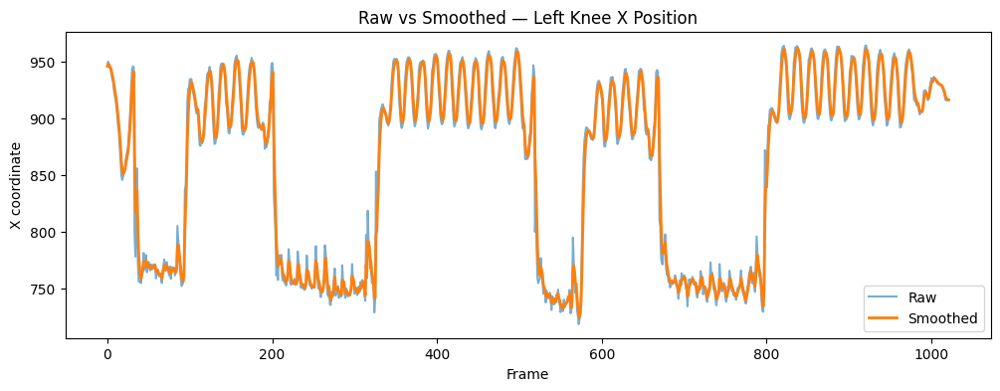

# YOLO Exercise Analysis

A computer-vision project that analyzes exercise videos using YOLOv8 pose estimation. The notebook processes squats and push-ups by detecting body keypoints, smoothing their movement over time, calculating joint angles, counting repetitions, and estimating how many reps meet simple form thresholds. It prints and saves a JSON summary and creates an annotated video for the combined-exercise example.

> **Note:** Form assessment is based on fixed joint-angle thresholds and is intended as a project demonstration, not medical or professional coaching advice.

## How it works

1. YOLOv8 Pose detects 17 body keypoints in sampled video frames.
2. Exponential moving average (EMA) smoothing reduces keypoint jitter.
3. Knee and elbow angles are used to detect squat and push-up repetitions.
4. Rep depth is compared with configured thresholds to classify reps as good or bad form.
5. The notebook prints and saves a JSON report; the combined-exercise example also writes an annotated MP4.

## Run the notebook

The project is provided as a Google Colab notebook. It uses Colab-specific imports and `/content` file paths, so run it in Colab rather than as a regular local Python script.

1. Open [`finalized_of_CV_Project.ipynb`](./finalized_of_CV_Project.ipynb) in [Google Colab](https://colab.research.google.com/).
2. In Colab, choose **Runtime → Change runtime type** and optionally select a GPU to speed up pose estimation.
3. Upload the three input videos to the Colab session's `/content` directory, using these exact filenames:
   - `CV_both_exercises_video_perfect_form.mp4`
   - `bad_pushup_video.mp4`
   - `bad_squat_video_2.mp4`
4. Run the notebook cells from top to bottom. The first cell installs the required packages, and the YOLOv8 pose weights download automatically when the model is loaded.
5. Find the generated files in Colab's **Files** pane. Download them before the runtime ends.

The input videos are not included in this repository. To use different videos, upload them to `/content` and update the corresponding `video_path` in the notebook.

## Outputs

- `exercise_output_both_exercises_perfect_form.json`
- `exercise_output_bad_pushup.json`
- `exercise_output_bad_squat.json`
- `annotated_output.mp4` — annotated video from the combined-exercise example

Each JSON report contains a video ID and the total, good-form, and bad-form repetition counts for the exercise(s) analyzed.

## Screenshot

The notebook compares raw and smoothed left-knee keypoint positions. The smoothed signal is less jittery than the raw detections.

